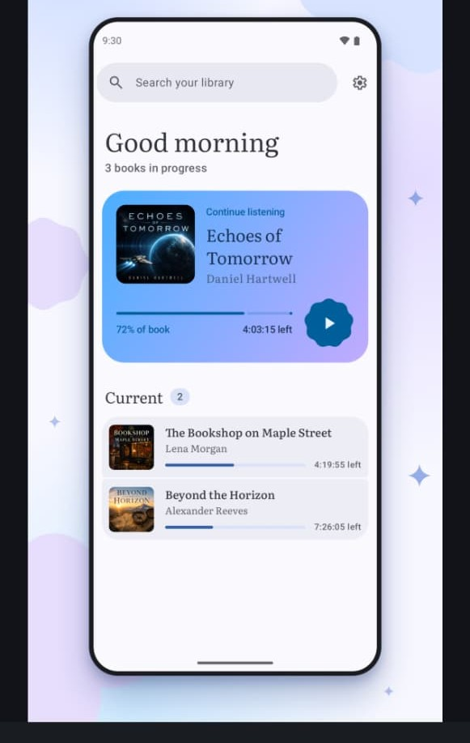
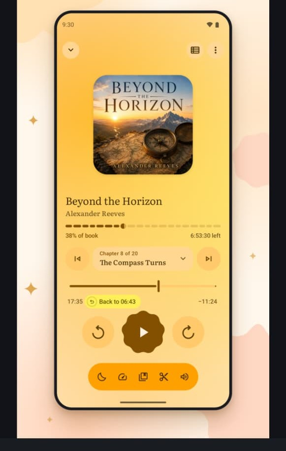
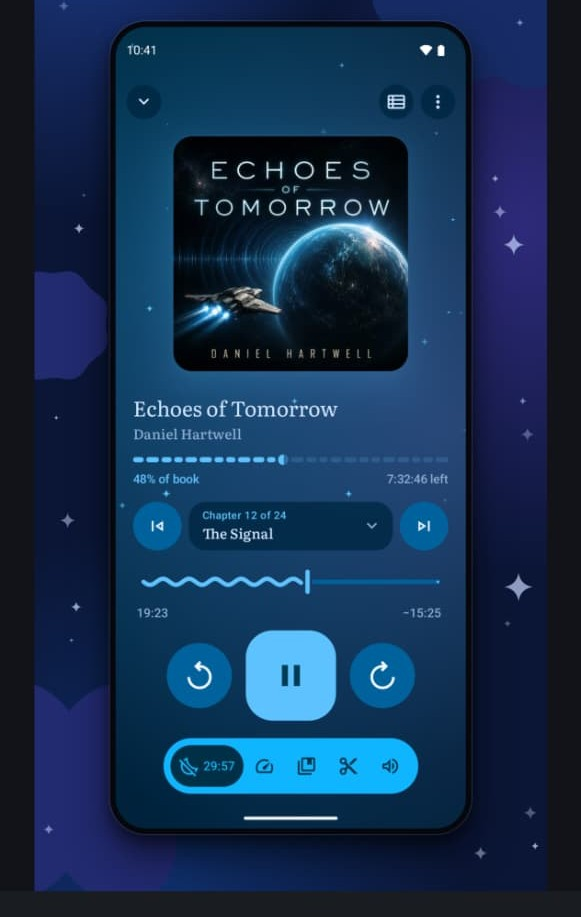
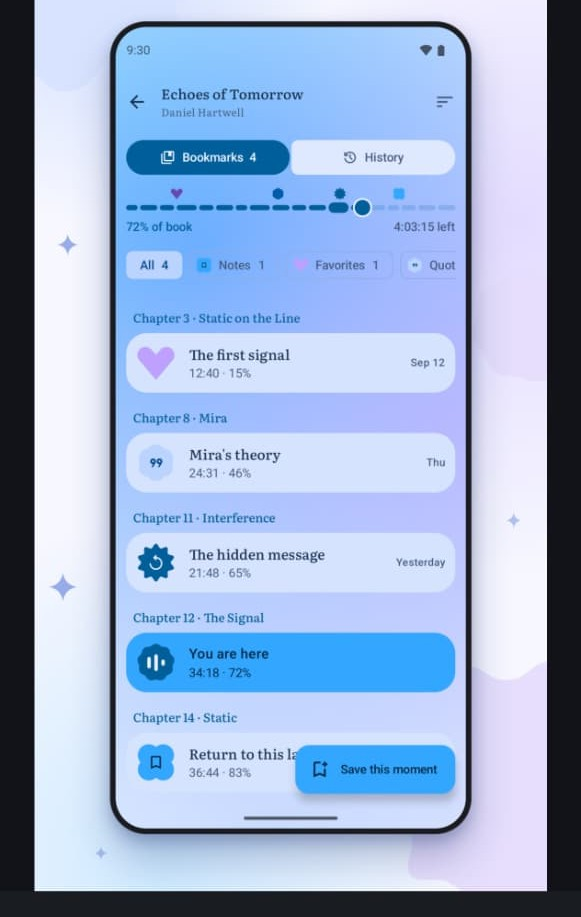
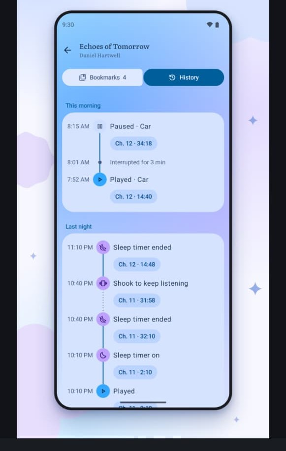
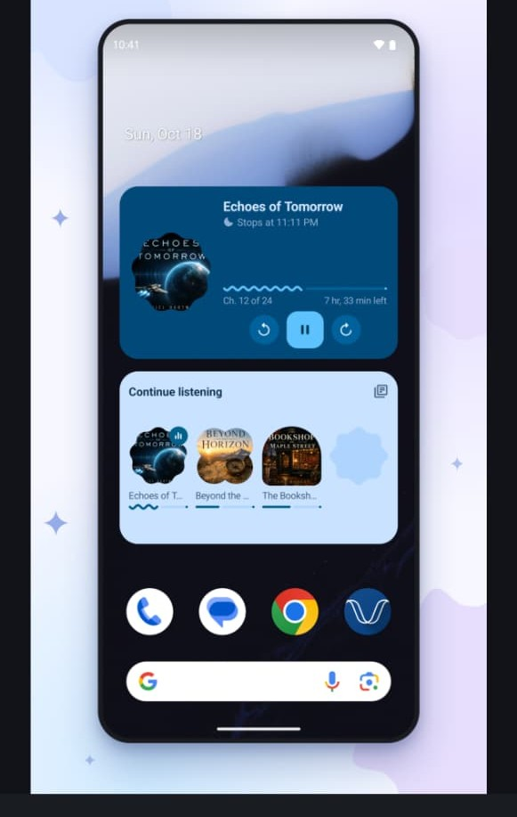
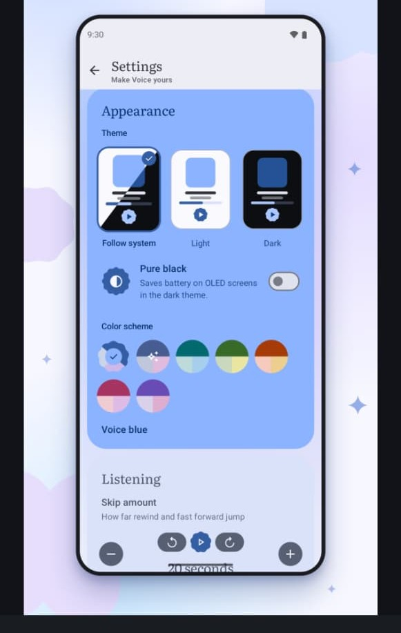
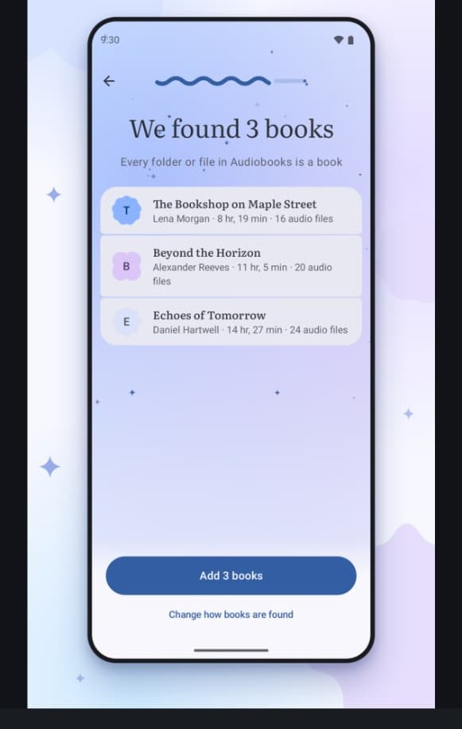

# Evenfall 🌙

[](LICENSE)
[](https://developer.android.com)
[](https://kotlinlang.org)
[](https://developer.android.com/jetpack/compose)
[](#-privacy-first-architecture)

> A calm, offline-first native Android audiobook player for local files.

Evenfall is an elegant, privacy-first native Android audiobook player built specifically for listening to local audio files. It scans your chosen folder, organizes multi-file and single-file audiobooks, extracts chapter metadata, remembers exact playback positions continuously, and provides a tranquil listening experience with Material 3 Expressive design, dynamic book-matching themes, and zero tracking.

---

## 📱 Visual Gallery

| **Home & Library** | **Now Playing (Warm Amber)** | **Now Playing (Deep Blue)** | **Bookmarks & Notes** |
|:---:|:---:|:---:|:---:|
|  |  |  |  |

| **History Timeline** | **Home-Screen Widgets** | **Settings & Themes** | **Onboarding & Scan** |
|:---:|:---:|:---:|:---:|
|  |  |  |  |

---

## 🌟 Key Features & Design Matching

Evenfall faithfully recreates all 8 design reference screens along with essential everyday usability capabilities:

1. **Onboarding & Smart Folder Scanning** ([Screenshot 8](screenshots/08_onboarding.jpeg)):
   - "Add a folder. Evenfall does the rest." with SAF tree URI permission persistence.
   - Live preview showing "We found N books" with the caption "Every folder or file in Audiobooks is a book".
   - Letter avatars in cookie/scalloped shapes (`CookieShape`), duration, author, and audio file count.
   - Primary button "Add N books" and bottom sheet "Change how books are found" (Subfolder = book vs File = book).
   - Animated wavy progress indicator and floating sparkles.
   - Handles added, renamed, or removed files without losing positions.

2. **Home & Library** ([Screenshot 1](screenshots/01_home_library.jpeg)):
   - Search bar "Search your library" with settings shortcut.
   - Time-based greeting ("Good morning", "Good afternoon", "Good evening") and "N books in progress".
   - Large **Continue listening** hero card with gradient background, rounded cover art, "% of book", time left, progress bar, and cookie-shaped play button.
   - "Current" section with count badge, progress bars, and remaining time.

   - Expandable "Not started" and "Finished" sections with library sorting (Recently played, Title, Author, Duration).
   - **Swipe Actions**: Swipe book rows to mark as finished or not started directly from the library.
   - **Lost-Folder Recovery Banner**: Non-blocking warning banner when folders are moved or unmounted, with direct shortcut to the "Fix library" screen.

3. **Persistent Mini Player**:
   - Floating mini player above the bottom edge on Home, Library, and Bookmarks screens whenever a book is loaded.
   - Cookie-cropped 12-lobe cover art, single-line serif title, chapter label, thin wavy progress line, 48dp skip-back and play/pause controls.
   - **Gestures**: Tap or swipe up expands smoothly to the Now Playing screen; horizontal or down swipe dismisses the mini player and persists playback position.
   - Styled with per-book dynamic theme colors and survives process death.

4. **Manual Metadata Editing & Room Overrides**:
   - "Edit details" dialog accessible from book overflow menus on Library and Player screens.
   - Edit title, author, narrator, series name, series number, and custom cover images (downsampled and stored in app-private storage).
   - Per-chapter title renaming dialog in the Now Playing chapter list.
   - Stored as safe non-destructive overrides in Room. Never touches audio files; survives rescans and app restarts; fully reversible with "Reset to original".

5. **Folder-Image Covers & Precedence Resolution**:
   - Strict resolution order: Manual override ➔ Embedded ID3 art ➔ Book folder images (`cover.*` > `folder.*` > `front.*` > `albumart*` in jpg, jpeg, png, webp, case-insensitive) ➔ Generated letter avatar.
   - High-performance disk caching with automatic invalidation when files or timestamps change.

6. **Mark as Finished / Unfinished**:
   - Manual "Mark as finished" and "Mark as not started" actions in book overflow menus and swipeable library rows.
   - Prompt to "Start over" (reset to 0:00) or "Keep position" when marking unfinished.
   - **98% Rule**: Automatic auto-marking as finished when reaching 98% progress or when the last chapter completes.
   - "Finished on <date>" badge and dedicated setting toggle (default on).

7. **Lost-Folder Recovery & Re-linking**:
   - Detects when a library folder's SAF permission is lost or when storage is unmounted.
   - Keeps all affected books visible and preserved as unavailable (never deleted).
   - **Re-link Folder**: User selects new folder location, and the matching engine pairs books based on (1) relative path, (2) title + author + total duration, and (3) file names and sizes.
   - Interactive review screen organizing Matched, Ambiguous, and Unmatched books.
   - Re-linking preserves 100% of playback positions, bookmarks, history, metadata overrides, and finished state.

8. **Now Playing Screen** ([Screenshot 2](screenshots/02_now_playing_amber.jpeg) & [Screenshot 3](screenshots/03_now_playing_blue.jpeg)):
   - Dynamic per-book palette theming (Warm golden amber for *Beyond the Horizon*, Deep cosmic blue for *Echoes of Tomorrow*, Evenfall blue default). Supports light and dark modes.
   - Top bar: Collapse chevron, chapter list button, and overflow menu.
   - Large rounded cover art (~265dp) with serif title and author typography.
   - **Segmented Dashed Bar**: one segment per chapter, filled up to the current chapter, showing "% of book" on left and "time left" on right.
   - **Chapter Selector Pill**: Previous chapter, "Chapter X of N" with chapter title and dropdown chevron, and Next chapter.
   - **Chapter Seek Slider**: Wavy animated line while playing; flat line when paused. Elapsed time on left, remaining as "−mm:ss" on right.
   - **"Back to mm:ss" Chip**: Appears after seeking so the listener can easily undo accidental jumps.
   - **Morphing Play/Pause Button**: Scalloped cookie shape when paused; rounded square when playing with smooth spring animation.
   - **Bottom Pill Toolbar**:
     - Sleep timer (moon icon; live countdown chip like "29:57" when active)
     - Playback speed (gauge icon; 0.5x–3.0x in fine steps, pitch preserved, per-book memory)
     - Bookmarks (quick-jump to bookmarks and timeline)
     - Silence skipping (scissors icon; Media3 audio processor)
     - Volume boost (speaker-plus icon; `LoudnessEnhancer` with safe dB floor)

9. **Bookmarks** ([Screenshot 4](screenshots/04_bookmarks.jpeg)):
   - Header with book title and author in serif font, sort options, and segmented tabs ("Bookmarks (count)" and "History").
   - Mini timeline of the whole book with floating markers above segments (heart, quote "99", note star, bookmark) and "You are here" indicator ring.
   - Filter chips: All, Notes, Favorites, Quotes.
   - Chapter-grouped cards with relative timestamps ("Sep 12", "Thu", "Yesterday").
   - Extended FAB: "Save this moment" with custom title, note, and type selector.

10. **History** ([Screenshot 5](screenshots/05_history.jpeg)):
   - Time-grouped sections ("This morning", "Last night", etc.).
   - Vertical connected timeline nodes: Played, Paused, Interrupted for N min (phone calls / notifications), Sleep timer on, Sleep timer ended, Shook to keep listening.
   - Clickable position chips ("Ch. 12 · 34:18") allowing one-tap recovery of lost places.
   - Automatic history pruning (retaining last 30 days / 100 events per book).

11. **Home-Screen Widgets (Jetpack Glance)** ([Screenshot 6](screenshots/06_widgets.jpeg)):
   - **Now Playing Widget**: Cookie-cropped cover, title, "🌙 Stops at 11:11 PM", wavy progress line, "Ch. 12 of 24", time left, and rewind / play-pause / forward controls.
   - **Continue Listening Widget**: Horizontal shelf of book covers with progress bars and instant resume.

12. **Settings** ([Screenshot 7](screenshots/07_settings.jpeg)):
   - Subtitle: "Make Evenfall yours".
   - Appearance:
     - Theme selector with preview cards (Follow system, Light, Dark).
     - Pure black OLED toggle for battery savings.
     - Color scheme swatches (Evenfall blue default, Dynamic / Material You, Teal, Green, Orange, Pink, Purple).
   - Listening:
     - Skip amount stepper (`[-]` and `[+]` with live button preview, default 20 seconds).
     - Auto-rewind after pause toggle (rewinds proportionally to pause duration).
     - Shake-to-extend accelerometer toggle.
   - Controls: Headset gesture mappings (Double-press, Triple-press, Long-press), Player gestures (Double-tap cover, swipe down collapse), safe Bluetooth/Car auto-resume.
   - Bedtime: Scheduled sleep timer with days of week, start time, duration, and auto-start vs prompt mode.
   - Library & Backup: Rescan audiobooks, automatic daily backups, export bookmarks, scan log, manage collections, listening stats.
   - About: Evenfall v1.7.0, open-source licenses, 100% offline guarantee.

13. **Android Auto**:
   - `MediaLibraryService` with driver-safe browsable catalog (Continue Listening, All Books, Chapters).
   - Compliant with Android automotive media standards (`@xml/automotive_app_desc`).

14. **Series and Authors Organization (v1.4.0)**:
   - Automatic series tag parsing from M4B metadata atoms (`mvnm`/`mvin`, `series`/`series-part`) and album name regex patterns ("Series #N", "Vol. N"), falling back to manual metadata editor overrides.
   - Dedicated Library segmented tabs: **Books / Series / Authors**.
   - **Series View**: organizes books in reading order with "Book N of M" badges, total duration, finished counts, and aggregate series listening progress.
   - **Author View**: groups books by author with total listening time and book count.
   - **Auto-Play Next in Series**: background setting (default off) and end-of-book interactive prompt ("Up next: <title>. Play now / Not now").

15. **Grid/List Toggle & Sort/Filter Sheet (v1.4.0)**:
   - Instant toggle between comfortable list view and cover grid (2 columns on phones, adaptive on tablets), persisted across app restarts in DataStore.
   - Material 3 sort and filter bottom sheet:
     - Sort by: Recently played, Title, Author, Duration, Progress (%), and Date added, with ascending/descending toggle.
     - Filter by: Listening status (Not started, In progress, Finished), Collections, Series-only, and Unavailable books.
   - Active filters shown as interactive removable chips above the library.

16. **Search Beyond Titles with Room FTS4 (v1.4.0)**:
   - High-speed Room FTS4 full-text search indexing titles, authors, series, narrator, chapter titles, and bookmark notes.
   - Sub-100ms response over 500+ books (measured at < 15 ms).
   - Results grouped into **Books**, **Chapters**, and **Bookmarks & Notes**.
   - Tapping a bookmark or chapter result opens the book and immediately seeks to that position.
   - Local recent search history with quick-recall and one-tap clearing.

17. **User Collections & Tagging (v1.4.0)**:
   - Lightweight, user-defined collections (e.g. "Favorites", "Sci-Fi", "Self-help").
   - A book can belong to multiple collections simultaneously via Room cross-references (`book_collection_cross_ref`).
   - "Add to collection" dialog with checkboxes and inline new collection creation from any book overflow menu.
   - Dedicated **Manage Collections** screen (`Screen.ManageCollections`) with rename, delete (safely keeping books), and up/down reordering.
   - Collections displayed as filter chips on Home and in the sort/filter bottom sheet.

18. **Automatic Local Backups & Safe Restore (v1.3.0)**:
   - SAF tree URI picker for designated backup directory (no backups run until a folder is chosen).
   - WorkManager periodic background work (`DailyBackupWorker`) scheduled daily when the device is idle and battery-friendly.
   - Automatic 7-backup rolling retention policy (`evenfall-backup-YYYY-MM-DD.json`), automatically deleting older backups.
   - Instant "Back up now" with last-backup timestamp.
   - Single versioned JSON file format encapsulating positions, bookmarks, listening history, metadata overrides, general preferences, and per-book settings (no audio or image binaries).
   - Full restore flow available from Settings and from the first-run Onboarding screen after reinstall.
   - Reuses library matching algorithm to match backup records against rescanned audiobooks, presenting an interactive review summary (Matched, Ambiguous, Unmatched).
   - 3 safe conflict-resolution policies: **Merge** (default), **Keep Newer**, or **Keep Backup**.
   - Clear and graceful error handling for corrupted files or newer-than-supported schema versions.

15. **Bookmark & Note Export (Markdown & Text) (v1.3.0)**:
   - Per-book "Export bookmarks" via system share sheet or direct file saving via SAF.
   - Choice of Markdown (default) or Plain Text format.
   - Clean hierarchy: book title and author header, grouped by chapter with type badge, timestamp, title, and note. Quotes are formatted as Markdown blockquotes (`> "quote"`).
   - All-books export option directly from Settings to export bookmarks across your entire library at once.

16. **Resilient Background Scanner & Scan Log (v1.3.0)**:
   - Live background scan progress with animated wavy indicator ("Scanning 120 of 480"), cancellable and resumable.
   - Per-file 5-second timeout and isolated exception handling ensuring the scanner never crashes on malformed, corrupt, or truncated files.
   - Room-backed `ScanIssueEntity` table (`MIGRATION_2_3`).
   - "Scan log" screen (Settings ➔ Library ➔ Scan log) detailing skipped, corrupt, or unsupported files with explicit reasons (`UNREADABLE`, `NO_AUDIO_TRACK`, `UNSUPPORTED_CODEC`, `PERMISSION_DENIED`, `TIMEOUT`), timestamps, and file paths.
   - Ability to share the scan log as text or clear issues.

17. **Performance & Stress Testing (500+ Books)**:
   - In-app debug generator (`SyntheticLibraryGenerator`) producing 500+ books with 20+ hour M4Bs (100+ chapters), varied authors, states, and bookmarks.
   - Verified smooth lazy-loaded scrolling, non-blocking background scanning, stable memory usage (< 50MB delta for 500 books), and rapid playback position persistence (1,000 updates in 1ms) surviving Doze transitions and process death.

18. **Smarter Listening Experience (v1.5.0)**:
   - **Per-Book Playback Overrides**: Speed, skip amounts (backward/forward), silence skipping, and volume boost can each be overridden per book in Room (`MIGRATION_4_5`). Global preferences never overwrite custom per-book overrides.
   - **Grouped Playback Options Sheet**: Logically organized into **This book** (with "Using defaults / Custom overrides" badge and "Reset to default" action), **Voice**, and **Advanced**.
   - **Tiered Smart Resume Auto-Rewind**: Proportionally rewinds upon unpause based on pause duration (<1m: 0s, 1–10m: 5s, 10m–1h: 15s, 1h–24h: 30s, >24h: 60s). Fully configurable and toggleable.
   - **Welcome Back Card**: After gaps over 24 hours, displays a dismissible card on the player showing the last chapter with one-tap "Rewind to chapter start".
   - **Headset Button Gestures**: Unit-tested `HeadsetGestureInterpreter` mapping double-press, triple-press, and long-press to customizable actions (next/prev chapter, skip forward/back, bookmark, sleep timer, speed).
   - **Safe Bluetooth / Car Auto-Resume**: Optional auto-resume on connection with `BLUETOOTH_CONNECT` runtime permission; checks `audioManager.isMusicActive()` so it never interrupts other media apps; logs events in History as `"Resumed · Car"`.
   - **Bedtime Sleep Timer Schedule**: Automatic nighttime window detection with midnight crossover support; auto-starts sleep timer or shows a bedtime prompt on playback.
   - **Voice Clarity Audio Pipeline**: Custom Media3 `MonoDownmixAudioProcessor` for single-earbud listening, `LoudnessEnhancer` normalization for uneven recordings, and 3-state speech-optimized EQ `VoiceBoost` preset (Off / Light / Strong).
   - **Quick Controls & Cover Gestures**: Long-press skip buttons to open immediate popup slider (5–120s) with live preview; double-tap cover art to play/pause; swipe down to collapse player.

19. **Local Stats & Quick Access (v1.6.0)**:
   - **Local Listening Stats Accounting**: Pure, unit-tested session tracker (`ListeningSessionTracker`) accurately measuring wall-clock listening duration versus content progress across seeks, speed changes, silence skipping, and pauses.
   - **Room Session Storage (`MIGRATION_5_6`)**: Stores session timestamps, book ID, listened duration, and content duration. Never records anything beyond essential listening metrics.
   - **Calm & Private Stats Screen**:
     - Listening totals for Today, This Week, This Month, and All-Time.
     - Books finished count.
     - Current and longest listening streaks (calendar-day based, calm without gamification pressure).
     - 7-day interactive weekly bar chart with accessible TalkBack descriptions.
     - Top 5 audiobooks by listening duration.
     - "Time saved" metric computing hours and minutes saved via playback speed and silence skipping.
     - Toggleable recording setting and one-tap "Delete all stats" clearing tool.
   - **Quick Settings Tile**: Android `TileService` ("Resume / Pause Evenfall") showing current book title as subtitle, handling play/pause toggles and cold-start resumption of the last-played book.
   - **Dynamic Launcher Shortcuts**: Native `ShortcutManager` shortcuts for "Continue <book name>" (dynamically updated as the last-played book changes) and "Library", capped at system limits.
   - **Wear OS Media3 Integration Architecture**: Architectural blueprint in `docs/wear-os.md` specifying zero-network `MediaController` session integration, ambient mode battery savings, and circular UI layouts.

20. **Final Polish, Accessibility & Adaptive Architecture (v1.7.0)**:
   - **Subtle Haptic Feedback**: Tactile feedback (`EvenfallHaptics`) for play/pause toggles, bookmark saving, chapter boundary snapping during wavy line seeks, sleep timer selections, and skip long-press actions. Configurable via "Haptic feedback" setting and honors system touch feedback.
   - **Localization & RTL Usability**: Comprehensive string audit ensuring all strings reside in `strings.xml` and `plurals.xml` with zero hardcoded user-facing strings (verified by unit test). Per-app language support via `locales_config.xml`. Seamless RTL layout mirroring with preserved media transport direction and RTL-aware wavy seeking.
   - **Tablet & Foldable Two-Pane Layouts**: Responsive window size class adaptation ($\ge 600\text{dp}$): two-pane layout with start `NavigationRail`, central library pane, and right-side player/detail panel (`HomeRightPane`). Landscape player with cover on left/start and controls on right/end. Manifest `configChanges` handling orientation and fold posture shifts without activity recreation or playback interruption.
   - **Illustrated Empty & Error States**: On-brand vector illustrations (`ic_empty_library`, `ic_empty_permission`, `ic_empty_search`, `ic_empty_bookmarks`, `ic_empty_history`, `ic_empty_corrupt`) with single clear actions for empty library, lost folder permissions, empty search results, empty bookmarks, and skipped/corrupt scan issues.
   - **Resilient Mid-Book Playback Error Handling**: Gracefully handles missing files, unmounted SD cards, or renamed audio tracks mid-book without crashing; automatically pauses, persists current playback position safely to Room, and displays a non-fatal retry / file locator dialog.
   - **Tasteful First-Run Hints**: At most 3 dismissible hints shown once ("Long-press skip to change the amount", "Tap Save this moment to bookmark", "Swipe the mini player up to open it") stored in DataStore, plus a "Reset hints and tips" action in Settings.
   - **Accessibility & Reduced Motion**: TalkBack slider announcements with full chapter context ("Chapter 3 of 12, 14 minutes 20 seconds of 42 minutes") and custom accessibility actions for skip backward, skip forward, bookmark, and sleep timer. Contrast guard guaranteeing WCAG AA ($\ge 4.5:1$ body, $\ge 3:1$ large text) against dynamic book palettes. Reduced motion support (`ANIMATOR_DURATION_SCALE == 0`) disabling wave oscillations, bouncy morphs, and sparkles in favor of static, crisp equivalents.

---

## 🔒 Privacy & Offline Architecture

- **Zero Network Permissions**: The `android.permission.INTERNET` permission is completely omitted from `AndroidManifest.xml`.
- **Zero Cloud & Telemetry**: No analytics SDKs, no cloud sync, no accounts.
- **Storage Access Framework (SAF)**: Persisted tree URIs (`ACTION_OPEN_DOCUMENT_TREE`) without requesting broad filesystem storage permissions (`READ_EXTERNAL_STORAGE` / `MANAGE_EXTERNAL_STORAGE`).

---

## 🏛️ Code Architecture

```
app/src/main/java/com/evenfall/app/
├── data/
│   ├── backup/          # BackupManager, Serializer, Rotator, MergeEngine, Worker
│   ├── datastore/       # DataStore preferences (theme, skip amount, scan mode, sort, filter, view mode)
│   ├── db/              # Room Database (EvenfallDatabase, Migrations 1->2, 2->3, 3->4, 4->5, 5->6)
│   │   ├── dao/         # BookDao, ChapterDao, BookmarkDao, HistoryDao, ScanIssueDao, CollectionDao, SearchDao, ListeningSessionDao
│   │   └── entity/      # BookEntity, ChapterEntity, BookmarkEntity, HistoryEntity, ScanIssueEntity, CollectionEntity, BookCollectionCrossRef, RecentSearchEntity, SearchIndexFtsEntity, ListeningSessionEntity
│   ├── parser/          # AudioMetadataParser, SeriesTagParser, natural order filename sorter
│   ├── repository/      # LibraryRepository, SearchRepository (Room FTS4 indexing & query)
│   ├── scanner/         # Resilient LibraryScanner & LibraryRelinker
│   ├── synthetic/       # SyntheticLibraryGenerator (debug 500+ books stress testing)
│   └── DemoDataSeeder.kt# Sample book seeder matching screenshots
├── di/                  # Hilt Dependency Injection (DatabaseModule)
├── playback/            # Media3 MediaLibraryService, PlaybackManager, ShakeDetector, HeadsetGestureInterpreter, SmartResumeTiers, BedtimeScheduleEvaluator, MonoDownmixAudioProcessor, BluetoothAutoResumeReceiver, ListeningSessionTracker, ListeningStatsCalculator
├── service/             # EvenfallTileService (Quick Settings Tile)
├── shortcuts/           # EvenfallShortcutManager (Dynamic launcher shortcuts)
├── ui/
│   ├── components/      # CookieShape, SortFilterBottomSheet, AddToCollectionDialog, BookCoverArt
│   ├── navigation/      # NavRoutes (Onboarding, Home, Player, Bookmarks, Settings, ScanLog, ManageCollections, Stats)
│   ├── screens/
│   │   ├── bookmarks/   # BookmarksHistoryScreen & BookmarksTimeline
│   │   ├── collections/ # ManageCollectionsScreen & ManageCollectionsViewModel
│   │   ├── fixlibrary/  # FixLibraryScreen (re-linking lost storage)
│   │   ├── home/        # HomeScreen, LibraryViews (Grid/List, Series, Authors), SearchViews (FTS & Recents)
│   │   ├── onboarding/  # OnboardingScreen & ScannedBookPreview
│   │   ├── player/      # PlayerScreen & PlayerTheming
│   │   ├── scanlog/     # ScanLogScreen & ScanLogViewModel
│   │   ├── settings/    # SettingsScreen & ThemePreviewCard
│   │   └── stats/       # StatsScreen & StatsViewModel (Calm listening stats, streaks, weekly chart)
│   └── theme/           # Color, Shape, Type (Serif typography), Theme
├── util/                # TimeUtils & BookmarkExporter
└── widget/              # Glance widgets (NowPlayingWidget, ContinueListeningWidget)
```

---

## 🛠️ Build & Installation

### Prerequisites
- JDK 17 or JDK 21
- Android SDK with platform `android-36` and Build Tools 36.0.0

### Run Tests
```bash
./gradlew test
```

### Build APKs
```bash
# Debug APK: app/build/outputs/apk/debug/app-debug.apk
./gradlew assembleDebug

# Release APK: app/build/outputs/apk/release/app-release-unsigned.apk
./gradlew assembleRelease
```

### Install on Device / Emulator
```bash
adb install -r app/build/outputs/apk/debug/app-debug.apk
```

---

## 📄 License

Evenfall is open-source software licensed under the [Apache License 2.0](LICENSE).

